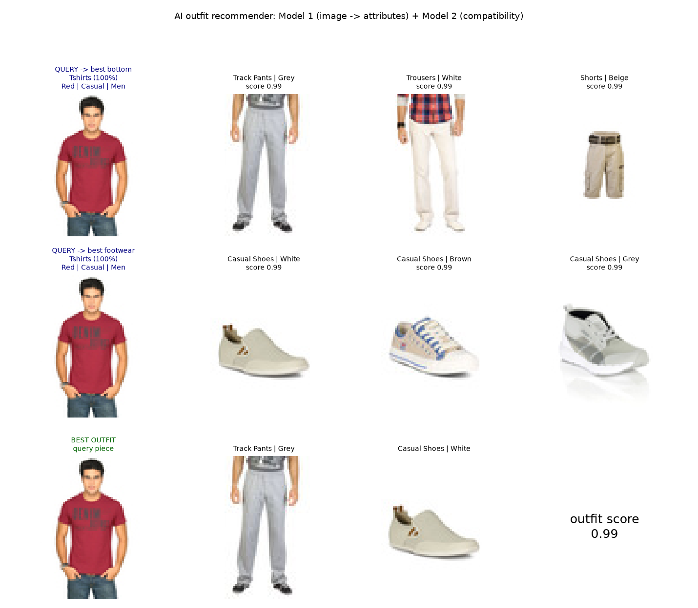
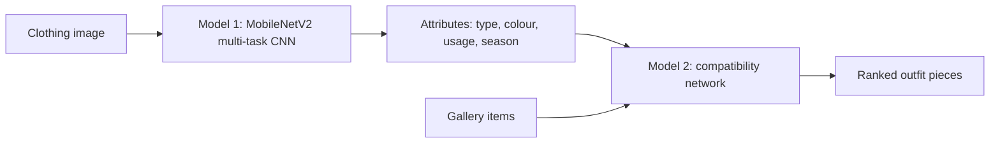
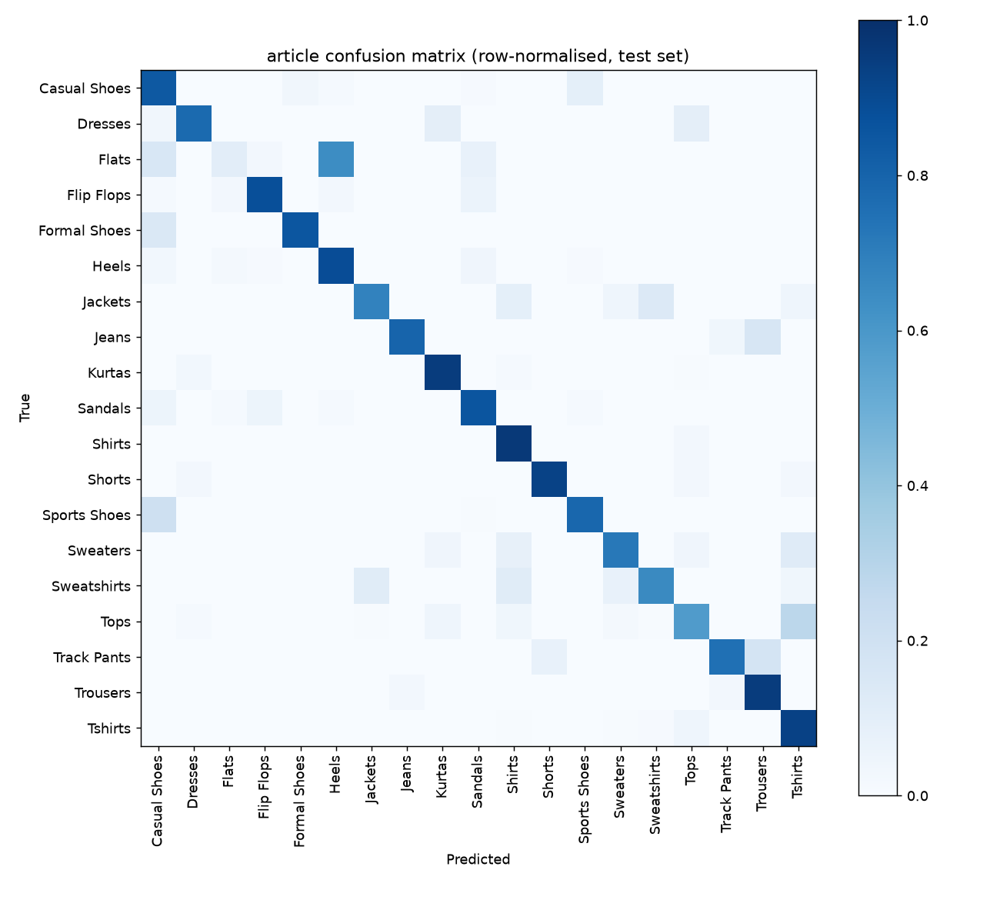
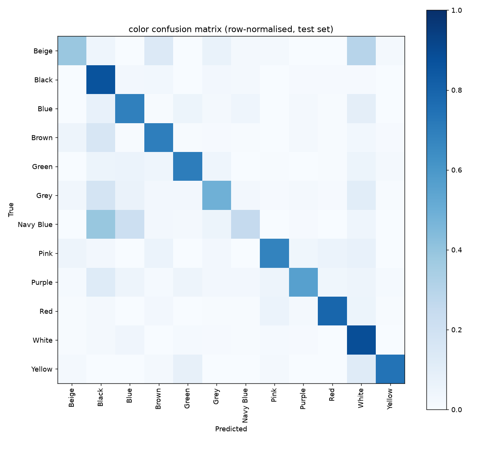

# AI Outfit Recommender


A two-model deep learning pipeline that looks at a clothing photo and recommends
matching pieces. A multi-task CNN turns the image into attributes, and a
compatibility network scores how well that item pairs with others.



## Overview



The Kaggle dataset used here has product images and attributes but no outfit-compatibility
labels, so the problem is split in two: **vision** (image to attributes) and **recommendation**
(attributes to compatibility). Each model is trained and evaluated separately, then
combined end to end.

## Results

### Model 1: image to attributes (held-out test set, 2,239 images)

| Attribute | Classes | Test accuracy |
|---|---|---|
| Article type | 19 | 85.6% |
| Usage | 4 | 90.8% |
| Base colour | 12 | 72.3% |
| Season | 4 | 70.3% |

Fine-tuning the upper backbone layers improved validation accuracy over the
frozen-backbone baseline (article 83.2% to 87.4%, colour 64.3% to 71.3%).

Error analysis: article-type mistakes are between visually similar classes
(Sports vs Casual Shoes, Tops vs T-shirts, Flats vs Heels) and stay within the same
outfit slot. Colour mistakes are mostly dark neutrals (Navy, Grey and Brown predicted as Black).

<p>
  
  
</p>

### Model 2: outfit compatibility (20,276 held-out test pairs)

| Setting | AUC / accuracy (all pairs) | AUC / accuracy (hard pairs*) |
|---|---|---|
| Model 1 predictions to Model 2 (full pipeline) | 0.975 / 93.8% | 0.835 / 89.4% |
| Ground-truth attributes to Model 2 (upper bound) | 0.992 / 95.9% | 0.948 / 93.0% |

\*Hard pairs are slot- and gender-valid pairs only. The all-pairs figure is inflated because
many negatives are trivially invalid (same slot, mismatched gender), so the
hard-pair figure is the more honest measure. The gap between the two rows is the
cost of Model 1's errors.

## Important note on the labels

No human-rated outfit data exists in this dataset. Compatibility labels were
**generated from hand-written style rules** (slot, gender, usage match, colour harmony,
season, known clashes such as formal shoes with shorts) plus small noise. Model 2
therefore learns a smooth version of those rules, not real human taste, and its
recommendations have not been evaluated by people. Replacing the rule-based labels with
human-curated data (for example the Polyvore Outfits dataset) is the main future
improvement.

## Example output

```
Model 1 predicts: Tshirts (100%) | Red | Casual | Men | slot=top

Top bottom picks:
   0.96  Shorts | Beige
   0.95  Trousers | White
   0.95  Trousers | Brown
Top footwear picks:
   0.99  Casual Shoes | White
   0.99  Casual Shoes | Brown
   0.99  Flip Flops | Black

Best full outfit (score 0.98): Tshirts + Shorts | Beige + Casual Shoes | White
```

## How it works

**Data preparation.** Clothing and footwear only; 19 article types mapped to outfit slots
(top, bottom, dress, footwear); adults only; 12 most common colours; 22,381 images split
80/10/10, stratified.

**Model 1.** MobileNetV2 (ImageNet weights) on 128x128 input with four softmax heads
(article, colour, usage, season). Two stages: train the heads on a frozen backbone,
then fine-tune the upper backbone layers with BatchNorm kept frozen at a low learning rate.
Augmentation is flips, zoom and small rotations, with no colour jitter so the colour head is not hurt.

**Model 2.** Each item is represented by Model 1's predicted probabilities plus gender
(42 values). A shared encoder embeds both items and a symmetric combiner
(sum, product and squared difference) guarantees score(A, B) = score(B, A). Trained on
160k balanced pairs; train, validation and test pairs are built within their own split
so test items are never seen in training.

**Inference.** Query image goes through Model 1, the item's slot is derived from the predicted
type, Model 2 scores it against every gallery item in the partner slots, and the best
three-piece outfit is chosen from the top candidates by averaging all three pairwise scores.

## Quickstart

Requires the Kaggle dataset
[Fashion Product Images (Small)](https://www.kaggle.com/datasets/paramaggarwal/fashion-product-images-small),
which is not included in this repo. Its terms are on the dataset page.

```bash
git clone https://github.com/singhvishal130405-boop/AI_Outfit_Recommender.git
cd AI_Outfit_Recommender
python -m venv .venv
.venv\Scripts\activate          # Windows; on Linux/macOS: source .venv/bin/activate
pip install -r requirements.txt
```

Place the dataset in `dataset/` (it should contain `styles.csv` and `images/`), or
point `DATA_DIR` at it. Then run the pipeline in order:

```bash
python data_prep.py          # clean data, encode labels, split
python train_model1.py       # stage 1: train heads
python finetune_model1.py    # stage 2: fine-tune backbone
python evaluate_model1.py    # test accuracy + confusion matrices
python build_pairs.py        # generate rule-based compatibility pairs
python train_model2.py       # train Model 2 + end-to-end evaluation
python demo.py               # random test item
python demo.py --image path/to/item.jpg --gender Men
```

Trained on CPU only (Windows). Model 1 stage 1 takes about 90 s per epoch and
fine-tuning about 90 s per epoch; Model 2 trains in a couple of minutes. Trained
models are also attached to the [Releases](../../releases) page.

## Project structure

| File | Purpose |
|---|---|
| `data_prep.py` | Cleaning, slot mapping, label encoding, splits |
| `train_model1.py` | Model 1 stage 1: frozen backbone, train heads |
| `finetune_model1.py` | Model 1 stage 2: fine-tune upper backbone |
| `evaluate_model1.py` | Test metrics, per-class report, confusion matrices |
| `build_pairs.py` | Rule-based compatibility labels and pair generation |
| `train_model2.py` | Model 2 training and end-to-end evaluation |
| `demo.py` | Image in, outfit recommendations out |

## Limitations

- Compatibility labels are rule-derived and have no human validation.
- Scores saturate near 1.0 for valid casual pairs, so the ranking among top picks is weak.
- Recommendations lean towards neutral colours because the rules treat neutrals as safe.
- Gender is supplied by the user, not predicted.
- Source images are 60x80 px; your own photos work best as a single garment on a plain background.
- Model 2 trained on Model 1 outputs for images Model 1 had already seen, so its training
  features are slightly cleaner than at test time.
- The gallery is the 2,239-item test split.

## Future work

- Train on human-curated outfit data (e.g. Polyvore Outfits).
- Feed image embeddings, not just attributes, into the compatibility model.
- Support a personal wardrobe as the gallery.
- Train Model 2 on noisier Model 1 features to close the gap to the upper bound.
- Add a simple web interface.

## Acknowledgements

Dataset: Param Aggarwal, *Fashion Product Images (Small)*, Kaggle.
Backbone: MobileNetV2 (Sandler et al., 2018), ImageNet pretrained weights via Keras.

## Author

Vishal Singh ([@singhvishal130405-boop](https://github.com/singhvishal130405-boop))

Released under the MIT License.
